# ✨𝓘𝓷𝓼𝓹𝓸𝓫𝓸𝓪𝓻𝓭🪐✨

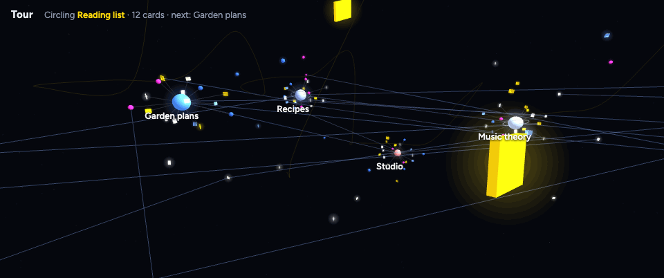

​				`(Or the ultimate adhd note taking app??)`

A local note app that puts ur notes in a 2D/3D universe,  and any item can link to any other.

- **Boards in boards, without end.** Open any card with its own cards and boards, to any depth. The path at the top takes you back up.
- **Link anything to anything, at any part.** A link can start or end on a whole card, on selected text, or on a spot in a saved web page or PDF. A click jumps there, on whatever board it lives. 
- **A free canvas.** No tree, no fixed flow. Put cards anywhere and put them in collections: an outline, a calendar, or a group.
- **Local and plain text.** A vault is a folder of Markdown and JSON Lines files. No account, no cloud. Atomic writes, undo for every action; supports snapshots and backups.

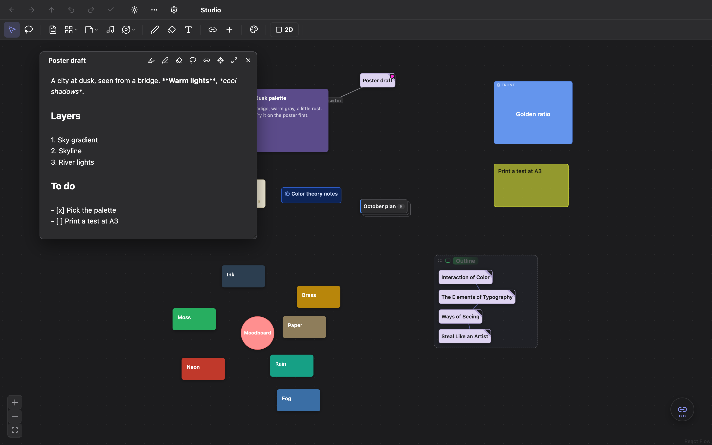

<p align="center"><sub>A board, with a page open: every page is also a plain Markdown editor (headings, lists, to-dos, links).</sub></p>

## Items

Every item is a card. Small items go on a board, in a page, or in a saved web page or PDF, in the same way. Medium items hold small items. Large items hold everything, other boards too. Multimedia items go on any board, and an outline or a group makes them an album or a playlist.

| | Item | Size | What it is |
|:---:|---|---|---|
| 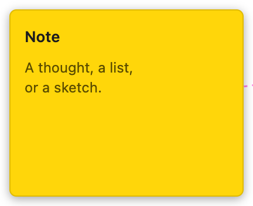 | **Note** | Small | A sticky note: a thought, a list, a sketch. |
| 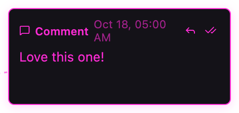 | **Comment** | Small | A remark on a card or a passage, with replies. |
| 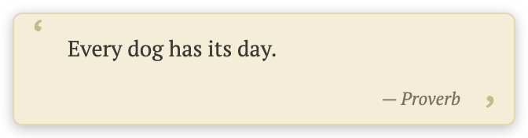 | **Quote** | Small | A quotation, with its source. |
| 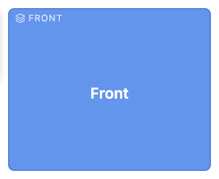 | **Flashcard** | Small | Front and back; double-click flips it. |
| 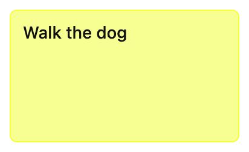 | **Action item** | Small | A to-do; check it off when it's done. |
|  | **Web link** | Small | A web address or a local file; a double-click opens it. |
| 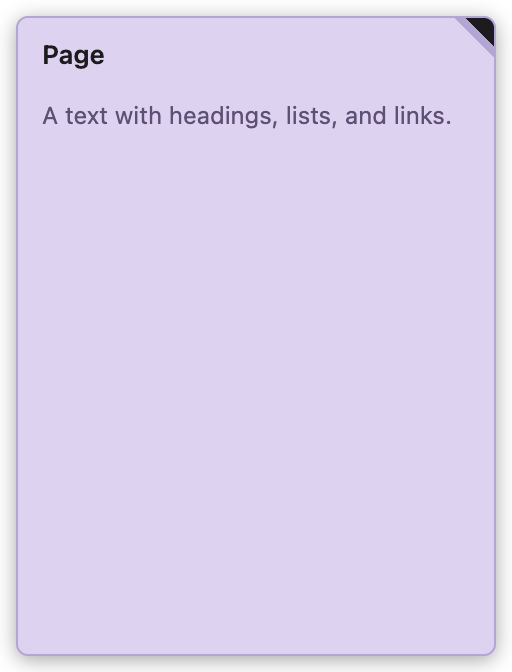 | **Page** | Medium | A Markdown text that holds small items inside it. |
|  | **Saved web page or PDF** | Medium | Your own copy of a page or PDF, with highlights and notes. |
| 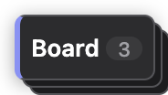 | **Board** | Large | A collection: a board with items of every size, and more boards. |
| 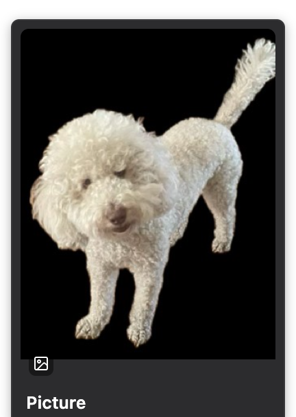 | **Picture** | Multimedia | A photo or an image. |
| 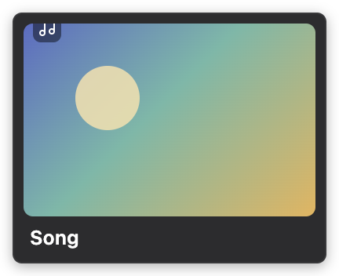 | **Song** | Multimedia | A song, with its artist and cover. |
|  | **Video** | Multimedia | A video, with its cover. |

## Use it as…

**A moodboard.** Photos of any size, pinned loosely and overlapping on a cork board, with notes, quotes, and links pinned beside them: a regular inspiration board. The cork board lies on the board (it moves and zooms with the cards, and holds them all); right-click the board to choose this for any background image. A link can point from a sentence in a page ("topknot") to a picture, and the notes in a collection link to their photos. *(Demo vault: `data/demo-dogs`.)*

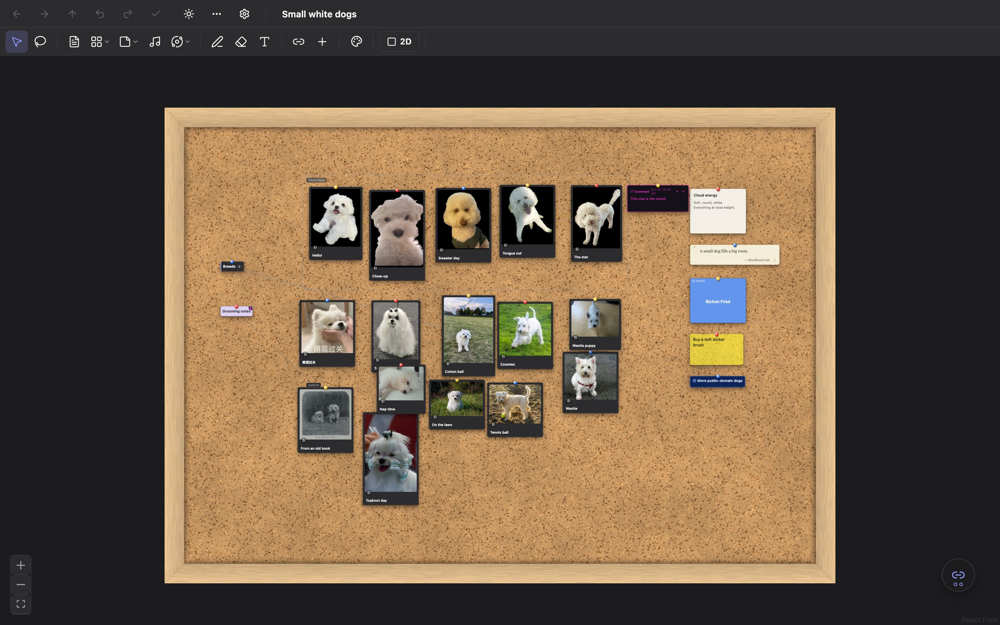

​			`*Shout out to my bestie Freud (that one in the sweater)`

**A branching story game.** Each scene is a page; each choice is a link on a sentence of the scene. Hover a choice, "Go to", and the next scene opens. The board shows the whole map of the story. *(Demo vault: `data/demo-story`.)*

| Play | The map of the story |
|---|---|
| 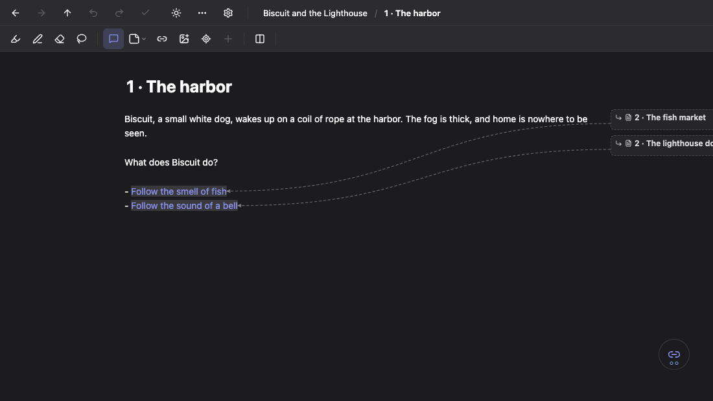 | 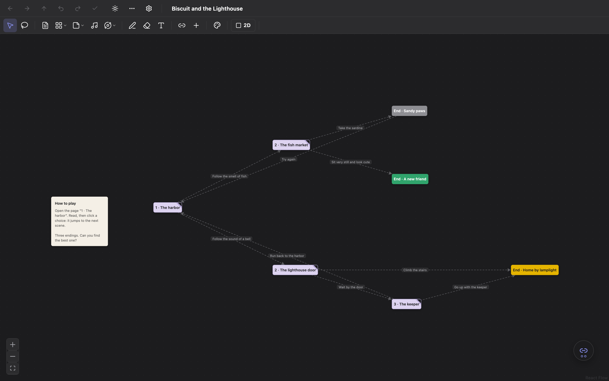 |

## Features

**3D galaxy and tour.** The whole structure as a galaxy: boards are stars, their cards orbit them, and links cross between them (the GIF at the top). 

**Buzzies mode.** It hides your text, and the app works as usual: for screenshots and demos.

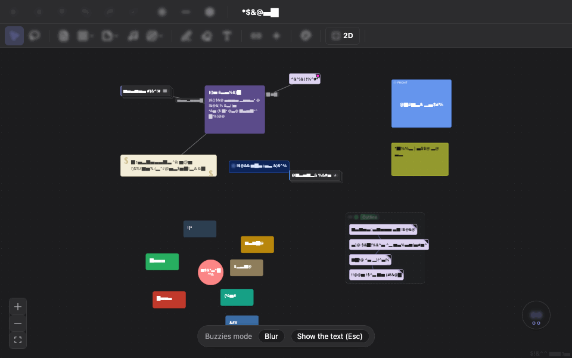

**Pages, calendars, and groups.** A card opens as a page with a Markdown editor, or as its own board (here, a board with a calendar).

| Page | Calendar | Galaxy (3D) |
|---|---|---|
| 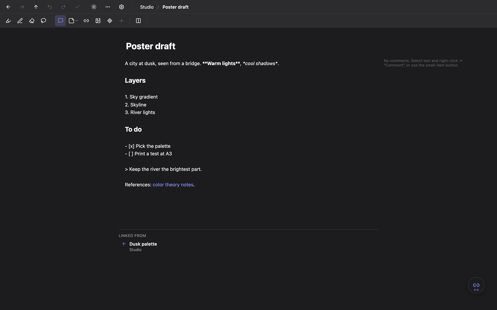 | 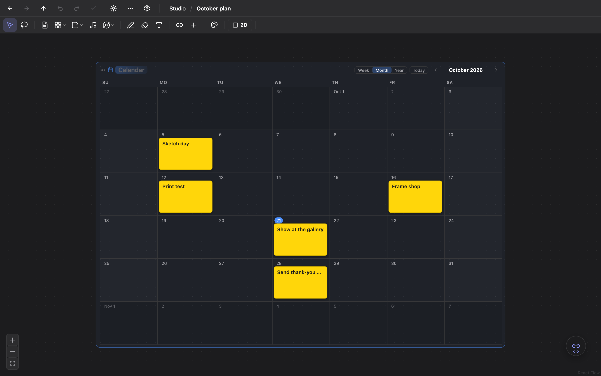 | 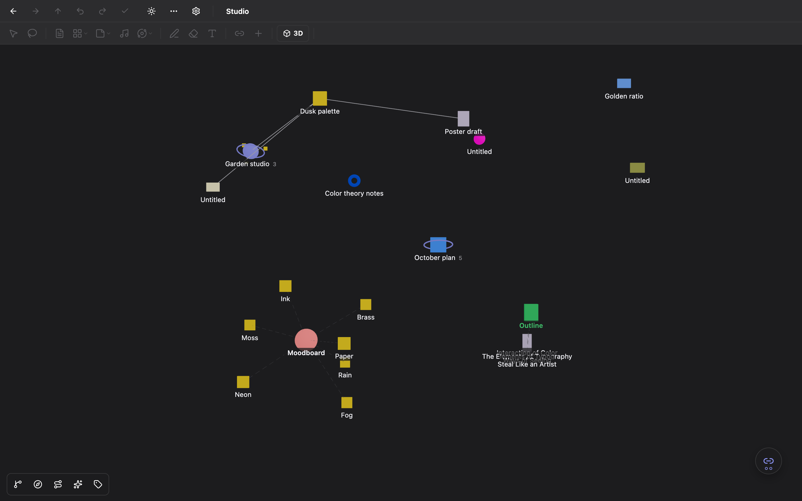 |

**Sorting maps and evolution plot.** A sorting map pulls items out of collections so you can organize them for the next stage. 3D evolution plot shows each generation of copies.

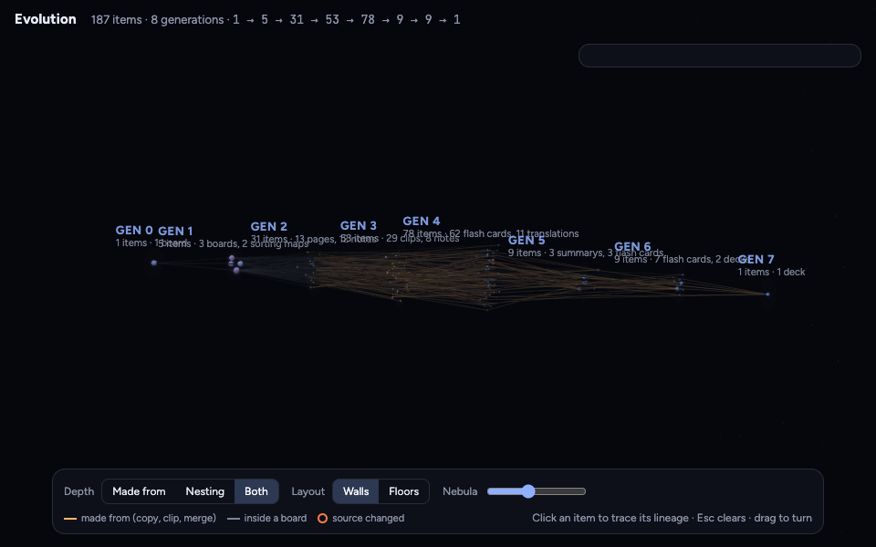

**Also**

- links between cards and between passages;
- saved web pages and PDFs, with highlights and notes;
- search, a trash, and a "Lost and found" for lost items;
- several vaults, each in its own window;
- light and dark themes;
- English, 简体中文, and 繁體中文.

## Plugins (optional)

Plugins are separate programs. They run on your computer, and each one is installed by hand ([docs/PLUGINS.md](docs/PLUGINS.md)). Their models download only when you ask for them in Settings.

| Plugin | What it does |
|---|---|
| `translate` | Translates text with a local model. |
| `voice` | Reads text aloud. |
| `web` | Saves web pages, and gets the title and cover of media links. |
| `chinese` | Converts between Simplified and Traditional Chinese. |
| `math`, `mathocr` | Formulas as spoken words; formulas from pictures. |
| `ask` (lab) | Answers questions from your notes with a local model. |
| `compare` (lab) | Compares two texts side by side. |

## Install and launch

`ask your local coding agent`

Inspoboard is a macOS app that you build from this repo (Windows and Linux builds are possible with Tauri, but not tested).

1. Install the tools once: [Node.js](https://nodejs.org) 20 or newer, [Rust](https://rustup.rs), and the Xcode command line tools (`xcode-select --install`).
2. Get the code and start the app:

   ```sh
   git clone https://github.com/selina-lii/inspoboard.git
   cd inspoboard
   npm install
   npm run app        # builds the app (a few minutes the first time), then opens it
   ```

3. Choose where your notes live: **New vault…** (any empty folder, for example `~/Documents/My vault`) or **Open vault…** (a folder you made before). Your notes stay in that folder, outside the repo, as plain files, so you can back it up, sync it, or move it. The repo holds only the app.
4. Keep the app: drag `src-tauri/target/release/bundle/macos/Inspoboard.app` into Applications. Next time, open it like any app. It asks for your vault folder (Vault › Open Vault…, ⌘O).

To try it first, open a demo vault: `data/demo-dogs` or `data/demo-story`.

Plugins are optional: `npm run plugins` builds `voice`, `translate`, `web`, `chinese`, `compare`, and `ask` (CMake is needed for `translate` and `ask`: `brew install cmake`); `math` and `mathocr` have their own README. Then see [docs/PLUGINS.md](docs/PLUGINS.md) to install them.

**For development:** `npm test` (unit tests), `npx tauri dev` (a development app; it opens only vaults inside `data/`, so it cannot change your own notes).

## Docs

- [docs/SPEC.md](docs/SPEC.md): the full specification (data model, vault format, views).
- [docs/PLUGINS.md](docs/PLUGINS.md): the plugin protocol.
- [manage/features.md](manage/features.md): the feature list, with tests and hand checks.

The pictures above use made-up vaults: a sample vault ([scripts/screenshots](scripts/screenshots/)) and the demo vaults ([scripts/demos](scripts/demos/)). The dog photos are public domain or CC0 ([credits](scripts/demos/dogs/CREDITS.md)), except the pictures given by the project owner. All README pictures are in [docs/images](docs/images/). To make the demo vaults again: `scripts/demos/make.ts`; the pictures: `scripts/screenshots/shoot.mjs`.

## License

Copyright © 2026 Selina Li. [GPL-3.0-or-later](LICENSE): you may use, change and share Inspoboard, and even sell copies, but anyone who gives out a copy (changed or not) must give its full source under the same license. The local models that plugins download have their own licenses (for example the Gemma terms).

`@selina-li` w/ the help of `@claude`

